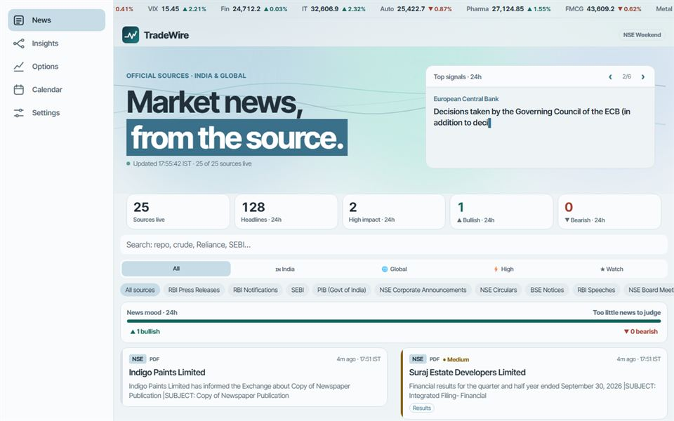

# TradeWire

Market news for Indian traders, read directly from official sources.

I built TradeWire for my own trading, because I wanted one place for RBI, SEBI and exchange news without opening a dozen sites. It runs as an Android app and a website from the same React Native code.

**Website:** https://tradewire.expo.app · **Android:** download the APK from [Releases](../../releases)



## What it does

- **Official sources:** RBI, SEBI, PIB, NSE, BSE, the US Fed, ECB, Bank of England, Bank of Japan, US SEC and US EIA. Optional media feeds can be switched on in Settings.
- **Headline tags:** each headline gets an impact level (High, Medium or Low), the sectors that usually react, and a direction (Bullish, Bearish or Mixed). For example, a rate cut points to banks, NBFCs, realty and autos.
- **News mood:** a gauge totals bullish and bearish headlines over the last 24 hours.
- **Options:** option chains for Nifty, Bank Nifty, Fin Nifty, Midcap Nifty, Nifty Next 50 and 218 F&O stocks, with PCR, max pain, call and put walls, OI build-up, ATM IV and implied move.
- **Intraday charts:** EMA 9/21, RSI 14, Supertrend, opening range and day range on a touch chart.
- **Planning:** a market calendar, a watchlist with results and ex-dates, an event-risk meter and a sector heatmap.

The tags are keyword rules based on headline wording. They are not investment advice or buy and sell signals.

## How it's built

| Layer | Choice |
|---|---|
| App and website | React Native, Expo, Expo Router, TypeScript |
| Charts | SVG |
| Android builds | EAS |
| Data | Official feeds and NSE market data, with no database |

**Android reads feeds directly and the website uses small server routes.** The phone can fetch each feed over HTTPS, so the app needs no backend, account or analytics. Browsers can't read those feeds directly, so the website goes through the routes in `src/app/api/`.

### Where to look in the code

| File | What it does |
|---|---|
| `src/sources.ts` | The list of feeds |
| `src/impact.ts` | Impact rules |
| `src/tone.ts` | Bullish and bearish rules |
| `src/nse.ts` | Option chain, intraday prices and sector indices |
| `src/optionStats.ts` | Option chain maths |
| `src/indicators.ts` | Intraday indicators |
| `src/insights.ts` | Insights calculations |
| `src/alerts.ts` | Background alerts |
| `src/store.tsx` | Shared state |
| `src/app/` | Screens |
| `tests/` | Logic, security and integration tests |

## Run it locally

```bash
npm install
npx expo start
```

Use `npx expo start --web` for the website.

To publish the website:

```bash
npx expo export --platform web
npx eas-cli deploy
```

To build an APK:

```bash
npx eas-cli build -p android --profile preview
```

## Privacy

The app has no account, analytics, ads or backend server, and its data stays on the device. Sites it fetches from can still see your IP address, so use a VPN or Orbot if you need to hide it.

## Version history

| Version | What changed |
|---|---|
| 1.6.0 | 13 more official sources and 11 optional media feeds, watchlist results and ex-dates, full-page website, new icon |
| 1.5.0 | Nifty Next 50 and 218 F&O option chains, new light theme, market tape and signal map |
| 1.4.0 | Website from the same code. Fixed the intraday chart running outside 9:15 to 15:30, undated older items jumping to the top, and chart taps losing their reading |
| 1.3.0 | Insights and Options tabs, index option chains, intraday indicators, colour-blind-safe up and down colours |
| 1.2.0 | Watchlist, market calendar, app lock, hidden screen, NSE holiday-aware market status |
| 1.1.0 | Bullish and bearish indicator, 24-hour news mood gauge |
| 1.0.0 | First release: official feeds, impact tags, background alerts |
